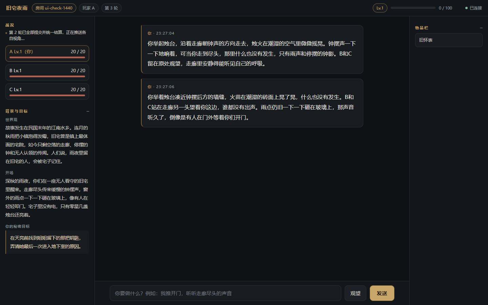
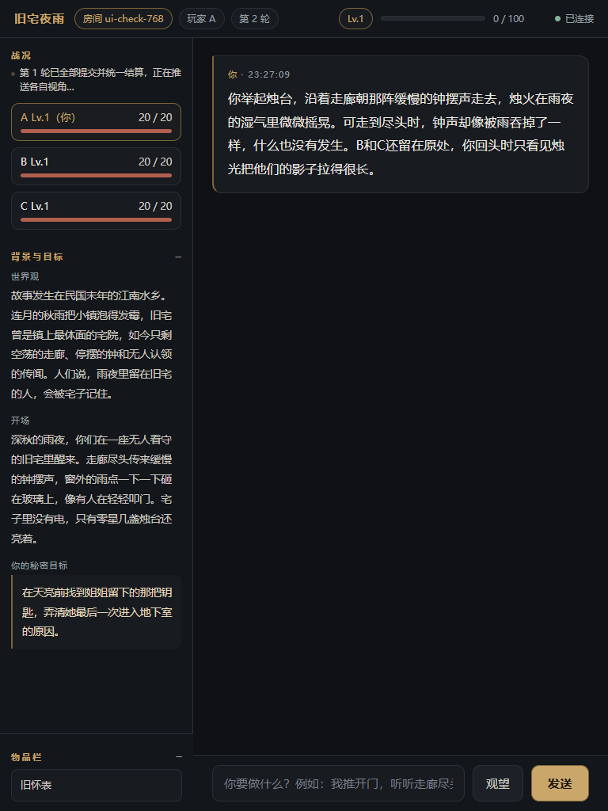
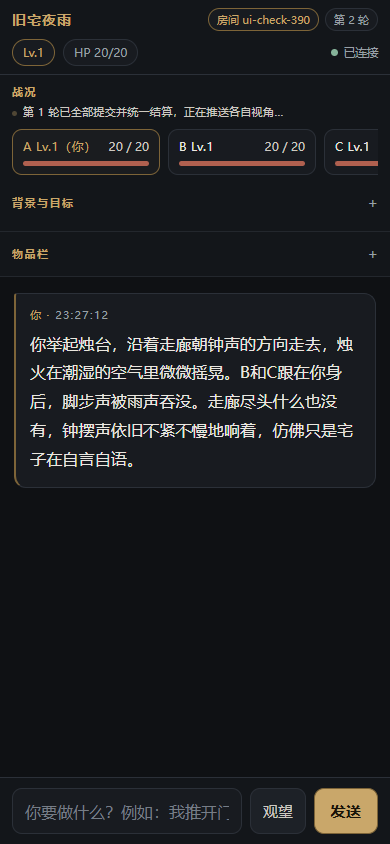
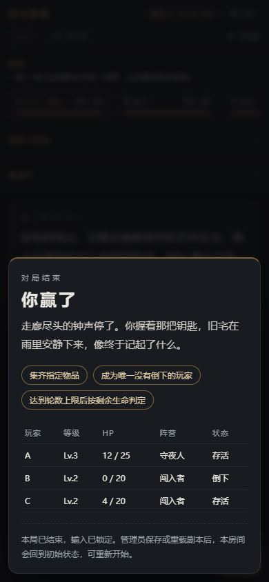
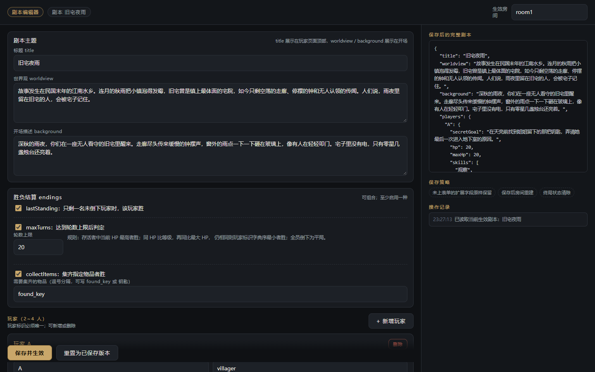

# 多人文字跑团（WebSocket 版）

一个由服务端统一裁决的多人文字对抗游戏：2~4 名玩家进入同一房间，各自提交行动，服务器在一轮结束时统一结算战斗、成长与事件，再为每位玩家单独调用大模型生成只属于他视角的叙事。房间、玩家、剧本（主题、世界观、开场、玩家设定、胜负条件）全部由服务端状态驱动，没有数据库。

仓库自带示例剧本《旧宅夜雨》，但标题、文案、玩家与胜负条件都只是剧本数据，可在 admin 编辑器中随时改写。

## 界面预览

桌面宽屏是「左侧状态栏 + 中间叙事 + 右侧物品栏」三栏布局：左边常驻轮次、全体玩家 HP 与剧本背景，中间按长文阅读排版叙事气泡，右边是随身物品。暗色基调、低饱和配色，正文对比度满足 WCAG AA。



平板自动收成两栏，物品栏移到左栏底部；手机（≤640px）改为单列纵向流，顶部只保留房间、轮次与自己的等级/HP，玩家卡横向滑动，输入框固定在底部并适配安全区。

| 平板端对局（768px） | 手机端对局（390px） |
| --- | --- |
|  |  |

终局时结算面板会给出胜负条件、结算叙述和每名玩家的最终状态，页面同时进入只读态；小屏下表格会自动收窄，不会横向溢出。



`admin.html` 与玩家页共用同一套配色和字体，按剧本动态渲染全部字段与胜负条件，支持 2~4 人增删玩家。



## 当前能力

- **多人动态房间**：2~4 人，玩家名册来自剧本，不再硬编码 A/B；不同房间状态严格隔离。
- **剧本完全可编辑**：`title` / `worldview` / `background` 三段文案、每名玩家的目标、物品、技能、阵营与战斗属性全部来自剧本；玩家页顶部与浏览器标题直接使用 `title`，不存在写死的主题文案。
- **可配置胜负结算**：`endings` 支持「集齐物品」「只剩一人」「回合上限」三种条件，可单用也可组合；终局后房间只读，并按玩家视角推送结算面板。
- **轮次与行动队列**：`/action` 只入队，所有在线玩家提交或超时后统一结算；未提交者按「观望」占位。
- **战斗裁决**：d20 + 攻击加值对抗 AC，伤害骰、命中/未命中、目标倒下全部由 Java 计算，模型只负责叙事。
- **经验成长**：击倒 +150 EXP、首次解谜 +60 EXP，100 EXP 一级，升级提升 maxHp 与攻击加值并回满 HP。
- **AI 叙事**：每位在线玩家一个独立 `CompletableFuture`，并发调用火山方舟 Agent Plan；带数值守门与失败降级。
- **剧本热更**：`POST /admin/scenario` 保存并重建指定房间；`GET /admin/reload` 从磁盘重载。
- **admin 编辑器**：`admin.html` 按剧本动态渲染全部字段（含 endings），支持 2~4 人增删玩家；保存时保留未上表单的字段。

## 技术栈

| 项目 | 版本 / 说明 |
| --- | --- |
| Java | 源码与字节码目标 Java 17（本机用 JDK 21 运行） |
| Spring Boot | 3.5.16（`spring-boot-starter-web`、`spring-boot-starter-websocket`） |
| WebSocket | Spring `TextWebSocketHandler`，端点 `/ws` |
| HTTP 客户端 | JDK `java.net.http.HttpClient` |
| JSON | Jackson（随 Spring Boot 引入） |
| 日志 | SLF4J + Logback |
| 大模型 | 火山方舟 Agent Plan，默认模型 `deepseek-v4-1-flash` |
| 数据库 | 无，全部状态在内存 |

## 目录结构

```text
（仓库根 = 本目录）
├─ pom.xml                            # Maven 配置；构建输出在仓库内 target/
├─ mvnw / mvnw.cmd                    # Maven Wrapper，无需本机安装 mvn
├─ .gitignore                         # 忽略 target/、日志、本地环境文件；docs/screenshots 走白名单
├─ scenarios/
│  └─ default.json                    # 剧本“版本源”（仓库里维护的唯一真相）
├─ src/main/java/com/example/pvp/
│  ├─ Application.java                # Spring Boot 启动类
│  ├─ api/                            # /action、/admin、/debug/log
│  ├─ combat/                         # 意图解析、骰子、战斗常量
│  ├─ ending/                         # 胜负判定（EndingService）与终局快照
│  ├─ growth/                         # 经验与升级常量
│  ├─ judge/                          # 一轮结算与战斗裁决
│  ├─ narrative/                      # 提示词渲染、模型调用、输出守门
│  ├─ scenario/                       # 剧本加载与校验
│  ├─ state/                          # GlobalState / PlayerState / PlayerView / 房间注册表
│  ├─ turn/                           # 行动队列、超时、结算编排
│  └─ ws/                             # WebSocket 处理器、在线会话表、送达日志
├─ src/main/resources/
│  ├─ application.yml                 # 端口、模型、剧本路径、超时、日志
│  ├─ prompts/                        # narrative_v1/v2/v3、levelup_v1
│  └─ static/                         # index.html（玩家页）、admin.html（编辑器）
├─ docs/screenshots/                  # README「界面预览」引用的界面截图
└─ README.md

target/                               # 构建产物与运行副本，已被 .gitignore 忽略
├─ ws-skeleton-0.1.0.jar              # 构建产物
└─ scenarios/default.json             # 运行副本（启动时读取，构建时从仓库源复制）
```

**剧本两份文件的关系**

1. `scenarios/default.json` 是仓库版本源。
2. `mvn package` 在 `process-resources` 阶段把它复制到 `target/scenarios/default.json`，这是进程启动时实际读取的运行副本。
3. `admin.html` 保存时会把完整 JSON **原子写入这两处**，所以重新打包不会把编辑结果冲掉。
4. 只看磁盘上运行副本、不改仓库源时，下次打包会被覆盖；推荐始终通过 admin 页面或 `POST /admin/scenario` 修改。

## 快速开始

要求：JDK 17+（推荐 21）。不需要本机安装 Maven，`mvnw` 会自动下载。

### PowerShell（Windows）

```powershell
# 1. 进入仓库根目录（clone 后的目录名）
cd Multiplayer-tabletop-role-playing-game-with-ai

# 2. 构建（产物在 target/）
.\mvnw.cmd -B -DskipTests package

# 3. 注入 Key 并启动（必须在仓库根目录下启动）
$env:ARK_API_KEY = "你的 Agent Plan API Key"
java -jar target\ws-skeleton-0.1.0.jar

# 可选：缩短轮次超时，方便测试
$env:TURN_TIMEOUT_MS = "10000"
```

### Bash / 通用 shell

```bash
cd Multiplayer-tabletop-role-playing-game-with-ai
./mvnw -B -DskipTests package
export ARK_API_KEY="你的 Agent Plan API Key"
java -jar target/ws-skeleton-0.1.0.jar

# 可选
export TURN_TIMEOUT_MS=10000
```

启动后访问：

| 页面 | 地址 |
| --- | --- |
| 玩家页（单人） | `http://localhost:8080/?room=solo&player=A` |
| 三人局 A | `http://localhost:8080/?room=team3&player=A` |
| 三人局 B | `http://localhost:8080/?room=team3&player=B` |
| 三人局 C | `http://localhost:8080/?room=team3&player=C` |
| 剧本编辑器 | `http://localhost:8080/admin.html` |

> 同一房间的玩家使用相同 `room`、不同 `player`。玩家标识必须存在于当前剧本的 `players` 里。

## 环境变量

| 变量 | 默认值 | 是否必填 | 作用 |
| --- | --- | --- | --- |
| `ARK_API_KEY` | 空 | AI 叙事必填 | OpenAI 兼容网关的 API Key（默认方舟）。为空时服务仍可启动，叙事直接降级为安全模板 |
| `ARK_MODEL` | `deepseek-v4-1-flash` | 否 | 模型 ID；方舟普通按量也可填 `ep-...` 接入点 |
| `ARK_BASE_URL` | `https://ark.cn-beijing.volces.com/api/plan/v3` | 否 | OpenAI 兼容 base，**必须含版本前缀**（如 `/v1`、`/api/v3`、`/api/plan/v3`），程序会自己拼 `/chat/completions`。若使用方舟 Agent Plan Key，不要指向 `/api/v3`，否则 401 |
| `ARK_THINKING_ENABLED` | `true` | 否 | 请求体是否发送方舟专属的 `thinking` 字段。OpenAI、DeepSeek、Moonshot、Ollama 等不认该字段的网关设为 `false` |
| `ARK_MAX_TOKENS` | `512` | 否 | 单次调用 `max_tokens`。厂商上限更低或上下文更小时调小 |
| `COMBAT_SEED` | 空（随机） | 否 | 固定掷骰种子。设置后同一进程内骰序可复现，便于测试 |
| `TURN_TIMEOUT_MS` | `30000` | 否 | 本轮超时毫秒数，从本轮第一个提交开始计时 |
| `SCENARIO_DIR` | `target/scenarios` | 否 | 运行副本目录（相对启动目录，即仓库根） |
| `SCENARIO_SOURCE_FILE` | `scenarios/default.json` | 否 | 仓库版本源路径（相对启动目录，即仓库根） |
| `SERVER_PORT` | `8080` | 否 | HTTP / WebSocket 端口 |

**安全约定**：本仓库不包含任何真实 Key。`ARK_API_KEY` 只从进程环境变量读取，不写入代码、配置、日志或 README。不要把 Key 提交到版本库，也不要把带 Key 的启动命令贴进 issue。

## 更换模型供应商

项目调用的是 **OpenAI 兼容的 `POST {ARK_BASE_URL}/chat/completions`**。服务端只依赖三件事：base URL、model、API Key。因此绝大多数提供 OpenAI 兼容接口的厂商都可以直接接入，**不需要改代码、不需要重新打包**。

### 三个核心变量

| 变量 | 语义 | 注意 |
| --- | --- | --- |
| `ARK_BASE_URL` | 网关根地址，**必须包含版本前缀** | 程序会自动拼 `/chat/completions`，不要自己写完整路径；末尾多余的 `/` 会被自动去掉 |
| `ARK_MODEL` | 模型 ID | 方舟普通按量也可填 `ep-...` 接入点；其他厂商填其模型名 |
| `ARK_API_KEY` | Bearer Key | 只从进程环境变量读取；程序发送 `Authorization: Bearer <key>` |

另有可选变量 `ARK_THINKING_ENABLED`（默认 `true`）与 `ARK_MAX_TOKENS`（默认 `512`）；每日调用上限可启动时加 `--ark.max-calls-per-day=200` 覆盖。换厂商时最常见的两个坑就是 `thinking` 和 `max_tokens`，见下文差异表。

### 各厂商配置示例

以下示例只写环境变量，Key 一律用占位符。模型名与 base 会随厂商版本变化，**标注「以厂商文档为准」的项请先核对官方文档**。

#### 1. 火山方舟 Agent Plan（当前默认）

```powershell
$env:ARK_BASE_URL = "https://ark.cn-beijing.volces.com/api/plan/v3"
$env:ARK_MODEL = "deepseek-v4-1-flash"
$env:ARK_API_KEY = "<你的 Agent Plan Key>"
```

- `thinking` 默认支持，保持 `ARK_THINKING_ENABLED=true`。
- 使用 Agent Plan Key 时不要把 base 改成 `/api/v3`，否则 401。

#### 2. 火山方舟普通按量

```powershell
$env:ARK_BASE_URL = "https://ark.cn-beijing.volces.com/api/v3"
$env:ARK_MODEL = "ep-<你的接入点ID>"   # 或控制台的模型 ID
$env:ARK_API_KEY = "<普通按量 API Key>"
```

- 普通按量 Key 与 Agent Plan Key 不通用。
- 方舟通常支持 `thinking`；若返回 400 指出未知字段，再设 `ARK_THINKING_ENABLED=false`。

#### 3. DeepSeek 官方

```powershell
$env:ARK_BASE_URL = "https://api.deepseek.com/v1"
$env:ARK_MODEL = "deepseek-chat"
$env:ARK_API_KEY = "<DeepSeek API Key>"
$env:ARK_THINKING_ENABLED = "false"
```

- 不认 `thinking` 字段，必须关闭。
- 建议用 `deepseek-chat`；`deepseek-reasoner` 可能把内容放在 `reasoning_content`、`content` 为空，叙事会被降级为安全模板。

#### 4. OpenAI

```powershell
$env:ARK_BASE_URL = "https://api.openai.com/v1"
$env:ARK_MODEL = "gpt-4o-mini"
$env:ARK_API_KEY = "<OpenAI API Key>"
$env:ARK_THINKING_ENABLED = "false"
```

- 不支持 `thinking` 字段，必须关闭。
- `gpt-4o-mini` 接受 `max_tokens`。o 系列 / 部分新模型改用 `max_completion_tokens`，本项目未适配，请选前者或自行改代码。
- 模型名以 OpenAI 文档为准。

#### 5. 通义千问（DashScope 兼容模式）

```powershell
$env:ARK_BASE_URL = "https://dashscope.aliyuncs.com/compatible-mode/v1"
$env:ARK_MODEL = "qwen-plus"
$env:ARK_API_KEY = "<DashScope API Key>"
$env:ARK_THINKING_ENABLED = "false"
```

- 使用 DashScope 的 `/compatible-mode/v1`，不要用原生 DashScope 路径。
- 不认方舟的 `thinking` 字段；如需千问的思考模式，请按其文档单独配置，本项目未适配。
- Moonshot 写法相同：`https://api.moonshot.cn/v1` + `moonshot-v1-8k`（以厂商文档为准）。

#### 6. 本地 Ollama / vLLM（无真实 Key）

```powershell
# Ollama
$env:ARK_BASE_URL = "http://127.0.0.1:11434/v1"
$env:ARK_MODEL = "qwen2.5:7b"          # 以 ollama list 为准
$env:ARK_API_KEY = "local"             # 本地服务不校验，但必须非空
$env:ARK_THINKING_ENABLED = "false"
$env:ARK_MAX_TOKENS = "256"
```

```powershell
# vLLM（--served-model-name 启动参数的值）
$env:ARK_BASE_URL = "http://127.0.0.1:8000/v1"
$env:ARK_MODEL = "your-served-model-name"
$env:ARK_API_KEY = "local"
$env:ARK_THINKING_ENABLED = "false"
```

- Ollama / vLLM 不校验 Key，但客户端要求 `ARK_API_KEY` 非空；填 `local` 这类占位值即可。若留空，程序会按「未配置 Key」直接降级，不会发起请求。
- 确认本地服务已启动、模型已拉取，且端口可达。

### 各家常见差异与处理

| 差异 | 典型表现 | 处理 |
| --- | --- | --- |
| `thinking` 字段 | 方舟支持；OpenAI、DeepSeek、Moonshot、千问兼容模式、Ollama 通常返回 400 unknown parameter | 设 `ARK_THINKING_ENABLED=false` |
| `max_tokens` 上限 | 各厂商上限不同，超限返回 400 | 调小 `ARK_MAX_TOKENS`；默认 512 对多数模型安全 |
| 模型名格式 | 方舟可用 `ep-` 接入点或模型 ID；其他厂商用模型 ID；Ollama 用 `name:tag` | 按厂商控制台/文档填写；`ep-` 只适用于方舟 |
| 额外 Header | 个别网关要求 `api-key` 等自定义头 | 当前客户端只发送 `Content-Type` 与 `Authorization`，这类网关需走其 OpenAI 兼容模式或改代码 |
| 返回内容为空 | 推理模型可能只返回 `reasoning_content`，`content` 为空 | 换非推理模型，或关闭其思考模式；程序对空 `content` 会降级 |
| `content` 为数组 | 部分网关返回 `[{"type":"text","text":"..."}]` | 已兼容，会拼接数组中的文本分段 |
| 旧版 `choices[0].text` | 少数网关不返回 `message.content` | 已兼容，会回退读取 `choices[0].text` |

补充：程序不读取 `usage.reasoning_tokens`，所以厂商缺少该字段不会报错；只要 `choices[0]` 里有可用文本即可。

### 换 Key / 换厂商的操作步骤

**PowerShell（临时，仅当前窗口）**

```powershell
$env:ARK_BASE_URL = "https://api.deepseek.com/v1"
$env:ARK_MODEL = "deepseek-chat"
$env:ARK_API_KEY = "<新 Key>"
$env:ARK_THINKING_ENABLED = "false"

# 必须重启进程后才会生效
java -jar target\ws-skeleton-0.1.0.jar
```

**PowerShell（持久，写入用户环境变量）**

```powershell
setx ARK_BASE_URL "https://api.deepseek.com/v1"
setx ARK_MODEL "deepseek-chat"
setx ARK_API_KEY "<新 Key>"
setx ARK_THINKING_ENABLED "false"
```

`setx` 只影响**新开的终端**；已经启动的服务和当前窗口都不会自动更新，必须重启进程。

**Bash（临时）**

```bash
export ARK_BASE_URL="https://api.deepseek.com/v1"
export ARK_MODEL="deepseek-chat"
export ARK_API_KEY="<新 Key>"
export ARK_THINKING_ENABLED=false
java -jar target/ws-skeleton-0.1.0.jar
```

**Bash（持久）**

```bash
# 建议手动编辑 ~/.bashrc，避免 Key 进入 shell 历史
echo 'export ARK_BASE_URL="https://api.deepseek.com/v1"' >> ~/.bashrc
echo 'export ARK_MODEL="deepseek-chat"' >> ~/.bashrc
echo 'export ARK_THINKING_ENABLED=false' >> ~/.bashrc
# Key 建议用 read -s 写入或使用密钥管理工具，不要直接 echo 到历史
```

> **重要**：环境变量只在进程启动时读取。服务已经运行时修改环境变量**不会生效**，必须停止进程后重新启动。

### 验证是否切换成功

1. 启动日志应出现类似：
   `叙事层初始化：baseUrl=... model=... timeout=9000ms maxTokens=512 ... thinking=false apiKey已配置=true`
   如果 `apiKey已配置=false`，说明 Key 没有传进进程。
2. 打开玩家页提交一条行动，等待轮次结算，应看到该模型生成的叙事，而不是固定模板。
3. 若日志出现 `叙事降级`，按状态码排查：
   - **401 / 403**：Key 错误、过期，或方舟 Agent Plan Key 用到了 `/api/v3`。
   - **404**：base 少了版本前缀、路径多了 `/chat/completions`，或模型名/接入点不存在。
   - **400**：多半是 `thinking` 不被支持、`max_tokens` 超上限、`temperature` 不被接受；先设 `ARK_THINKING_ENABLED=false`，再调小 `ARK_MAX_TOKENS`。
   - **超时 / 连接失败**：URL 不通、本地服务未启动、代理或防火墙拦截。
   - **响应解析失败且 body 里 content 为空**：模型是推理模型或返回结构不兼容，换普通对话模型。
4. 模型输出即使成功返回，也会经过 `OutputValidator` 守门；若叙事里出现该玩家视角外的数字或他人私密信息，会被替换为安全模板。这是守门生效，不是厂商接入失败。

### 安全提醒

- Key **只能**放在进程环境变量 `ARK_API_KEY` 中，不要写进剧本 JSON、`application.yml`、README 示例或前端代码。
- README 与示例里的 Key 一律是占位符；不要把真实 Key 贴进 issue、聊天记录或提交历史。
- `setx` 与 `~/.bashrc` 都是明文存储；多人机器建议使用系统密钥管理或仅在该终端临时导出。
- 如果 Key 曾经出现在日志、截图或提交历史里，公开仓库前先到厂商控制台轮换。

### 能力边界

不同厂商只影响叙事文本的措辞与风格；战斗裁决、数值成长、叙事守门与胜负结算全部在 Java 侧计算，不依赖模型，也不会因换厂商而改变。

## 接口清单

### 1. WebSocket `/ws?room={room}&player={player}`

建立后立即收到一份初始 `PlayerView`，之后每次结算与新一轮开始都会推送。

- `room`：1~32 位字母/数字/下划线/短横线，必填。
- `player`：必须是当前剧本 `players` 的键，必填。
- 参数缺失/非法会以 `BAD_DATA` 关闭连接，不做默认房间兜底。
- 同一玩家重复连接会关闭旧会话。

初始消息示例（节选）：

```json
{
  "room": "team3",
  "playerId": "A",
  "hp": 20,
  "maxHp": 20,
  "exp": 0,
  "level": 1,
  "expPerLevel": 100,
  "title": "旧宅夜雨",
  "worldview": "故事发生在民国末年的江南水乡……",
  "background": "深秋的雨夜……",
  "secretGoal": "在天亮前找到姐姐留下的那把钥匙……",
  "myInventory": ["旧怀表"],
  "visibleEvents": [],
  "publicPlayers": [
    {"playerId": "A", "name": "A", "level": 1, "hp": 20, "maxHp": 20, "armorClass": 10, "defeated": false},
    {"playerId": "B", "name": "B", "level": 1, "hp": 20, "maxHp": 20, "armorClass": 10, "defeated": false},
    {"playerId": "C", "name": "C", "level": 1, "hp": 20, "maxHp": 20, "armorClass": 11, "defeated": false}
  ],
  "turn": 1,
  "onlinePlayers": ["A", "B", "C"],
  "submittedPlayers": [],
  "narrativeText": "",
  "levelUpNarrative": "",
  "ending": null
}
```

`title` / `worldview` / `background` 直接来自剧本；`ending` 在未结束时为 `null`，终局后变为结算视图（见下文「终局行为」）。

### 2. `POST /action`

把一条行动放入本房间的行动队列。提交是**即时返回**的；只有最后一个提交触发结算时，该请求才会等待叙事生成完成。

请求体：

```json
{
  "room": "team3",
  "from": "A",
  "intent": "我攻击C",
  "private": true,
  "skip": false
}
```

- `skip=true` 表示「观望/跳过」，等价于提交无行动，`intent` 可为空。
- `private` 必填布尔值。
- 攻击目标由服务端从 `intent` 中解析；目标必须在本房间且在线。

已记录（等待结算）响应 `200`：

```json
{
  "room": "team3",
  "player": "A",
  "turn": 1,
  "intent": "我在客厅里搜寻线索",
  "overwritten": false,
  "submittedCount": 1,
  "onlineCount": 3,
  "submittedPlayers": ["A"],
  "onlinePlayers": ["A", "B", "C"],
  "waitingFor": ["B", "C"],
  "status": "queued",
  "message": "已记录，等待本轮结算（已提交 1/3）"
}
```

本次提交触发结算时，响应额外包含 `reason`、`events`、`deliveredTo`，`status` 为 `settled`：

```json
{
  "status": "settled",
  "reason": "all_submitted",
  "events": [
    {
      "eventId": "e4",
      "type": "attack",
      "actor": "A",
      "intent": "我攻击C",
      "result": "hit",
      "isPublic": true,
      "visibleTo": [],
      "combat": {
        "attacker": "A",
        "target": "C",
        "attackRoll": 14,
        "attackBonus": 2,
        "attackTotal": 16,
        "targetAc": 11,
        "hit": true,
        "damageDice": "1d6",
        "damageRoll": 4,
        "damage": 4,
        "targetHpRemaining": 16,
        "targetDefeated": false
      },
      "growth": null
    }
  ],
  "deliveredTo": ["A", "B", "C"]
}
```

若本轮结算同时触发终局，响应还会带 `finished=true` 与 `ending`（主条件、全部条件、胜者、各玩家最终状态），例如（节选）：

```json
{
  "status": "settled",
  "reason": "all_submitted",
  "finished": true,
  "ending": {
    "condition": "collect_items",
    "conditions": ["collect_items"],
    "winnerId": "A",
    "turn": 1
  },
  "deliveredTo": ["A", "B", "C"]
}
```

错误码：

| HTTP | error | 场景 |
| --- | --- | --- |
| 400 | `bad_request` | room/from/intent/private 缺失或非法 |
| 404 | `player_not_connected` | 提交者本人没有打开的 WebSocket |
| 404 | `target_not_connected` | 攻击目标不在本房间或不在线 |
| 409 | `settling` | 本轮正在结算，未入队 |
| 409 | `room_finished` | 本房间已终局，不再接受任何新行动；响应体含 `error` 与提示胜者的 `message` |

### 3. `GET /debug/log?room={room}&player={player}`

返回该玩家实际收到的全部消息，按送达顺序：

```json
[
  {
    "seq": 1,
    "receivedAt": "2026-11-13T21:45:14.123+08:00",
    "message": { "room": "team3", "playerId": "A", "turn": 1, "narrativeText": "……" }
  }
]
```

未知房间或玩家未收到消息时返回 `[]`；`room` 缺失/非法或 `player` 缺失返回 `400`。

### 4. `GET /admin/scenario`

返回当前生效的完整剧本 JSON（结构与 `scenarios/default.json` 一致），`Cache-Control: no-store`。

### 5. `POST /admin/scenario?room={room}`

请求体为完整剧本 JSON。流程：整体校验 → 原子写入运行副本与仓库源 → 重新加载 → 重建该房间。

```json
{
  "room": "team3",
  "status": "saved",
  "created": false,
  "scenario": "旧宅夜雨",
  "activePath": "E:\\...\\target\\scenarios\\default.json",
  "sourcePath": "E:\\...\\scenarios\\default.json",
  "sameFile": false,
  "sourceSynced": true,
  "players": {
    "A": {"hp": 20, "maxHp": 20, "items": ["旧怀表"]},
    "B": {"hp": 20, "maxHp": 20, "items": ["火柴盒"]},
    "C": {"hp": 20, "maxHp": 20, "items": ["生锈短刀"]}
  },
  "message": "剧本已保存并生效，房间已重建为初始状态；在线连接保留，刷新玩家页面即可看到新视角"
}
```

校验失败返回 `400`，`error=scenario_invalid`，`message` 含具体字段（如 `players.A.hp 必须在 1~20 之间`），磁盘文件不会被修改。

### 6. `GET /admin/reload?room={room}`

从磁盘重新读取运行副本并重建指定房间：

```json
{
  "room": "team3",
  "status": "reloaded",
  "created": false,
  "scenario": "旧宅夜雨",
  "players": {
    "A": {"hp": 20, "maxHp": 20, "items": ["旧怀表"]}
  },
  "message": "该房间已重建为剧本初始状态：HP/背包/事件/送达日志全部重置；在线连接保留"
}
```

## 玩法与规则

### 轮次与结算

1. 每条 `/action` 进入当前房间的 `actionQueue`（`playerId -> Action`）。
2. 满足以下任一条件即结算：
   - 房间内**所有在线玩家**都已提交；
   - 从本轮**第一个提交**开始计时，超过 `TURN_TIMEOUT_MS`（默认 30 秒）。
3. 超时后，未提交的**在线玩家**生成公开的观望事件（`intent=idle`、`result=idle`），不会丢人。
4. 结算顺序固定按 `playerId` 字典序，先基于轮初快照规划，再按顺序记账。
5. 结算完成后清空队列、轮次 +1，并向在线玩家广播新一轮 `PlayerView`（含新的轮次号，`submittedPlayers=[]`）。若本轮触发终局，则轮次停住、不再广播新一轮，房间进入只读状态。

**参与者定义**：本轮参与者 = 在线玩家 ∪ 已入队玩家。从未上线且没有入队行动的剧本玩家不会出现在本轮事件里，避免虚构行动。

### 胜负结算与终局

一轮的裁决、事件与成长全部落账之后才判定胜负，因此「击倒最后一人」「拿到关键物品」都发生在同一轮结算内生效。

三种条件由剧本 `endings` 配置，可只启用一种，也可组合：

| 条件 | 触发规则 | 胜者 |
| --- | --- | --- |
| `collectItems` | 某玩家的背包集齐 `items` 列表中的全部物品 | 该玩家；多人同时集齐时取 `playerId` 字典序最小者 |
| `lastStanding` | 房间内只剩一名未倒下的玩家 | 该玩家 |
| `maxTurns` | 结算完成的轮次 `turn >= turns` | 存活者中 `hp` 最高者；同 HP 比 `level`，再同比 `maxHp`，仍相同取 `playerId` 字典序最小者；全员倒下则平局 |

- **组合优先级固定为 `collectItems` > `lastStanding` > `maxTurns`**，所以同一轮同时满足多个条件时结果稳定、可复现。
- 结算结果会记录「本轮满足的全部条件」，面板全部展示；但决定胜负的只有主条件与它产生的胜者。
- `collectItems` 的物品匹配同时接受机制标识（如 `found_key`）与其自然语言别名（如「钥匙」），两者视为同一件物品。

终局后的行为：

- 房间标记为已结束：`POST /action` 一律返回 `409 room_finished`，响应 `message` 会指出胜者或「平局」；不再开启新轮，已有事件、送达日志与历史全部保留，不清空。
- 每位在线玩家会收到各自视角的 `PlayerView.ending`，包含 `outcome`（`win`/`lose`/`draw`）、`condition`/`conditions`、`winnerId`、`youWin`、`narrative`，以及全体玩家的最终公开状态（等级、HP/maxHp、AC、是否倒下、阵营）。
- 结算面板会列出触发条件与每名玩家的结果，页面进入只读状态（输入框与发送/观望按钮禁用）。
- 结算叙述由确定性模板生成（`《剧本标题》落幕……`），不依赖大模型；大模型不可用时叙事降级，但结算结果与叙述照常送达。
- `POST /admin/scenario` 保存或 `GET /admin/reload` 重建房间会清除终局状态，房间回到剧本初始状态，可以重新开始。

### 重复提交与断线

- 同一玩家在同一轮重复提交会覆盖旧行动，响应 `overwritten=true`，并提示「已覆盖你本轮此前的行动」。
- 结算进行中提交返回 `409 settling`。
- 玩家断线时，**已入队的行动保留**并照常参与结算；若剩余在线玩家都已提交，或房间已无人在线，则立即结算，否则等超时。

### 战斗与同时攻击

- 命中/伤害全部基于**轮初快照**：攻击加值、目标 AC、目标轮初 HP 在结算开始时固定。
- 多个玩家同时攻击同一目标时，伤害按 `playerId` 顺序依次记账；显示给玩家的 `targetHpRemaining` 是记账后的真实剩余值。
- 轮初 HP 已为 0 的玩家不能出手，按观望占位。
- 攻击轮初已倒下的目标：`result=already_down`，伤害 0。
- 目标 HP 跨过 0 的那一次攻击标记 `target_down`，并且只给该攻击者结算一次胜利 EXP（+150）。
- 本轮结束时统一追加 `down` 事件。

### 阵营可见性（最小实现）

- 剧本可为每个玩家声明可选 `faction`（如 `villager` / `killer`）。
- 私有事件（`private=true`）的 `visibleTo` = 本人 + 同阵营队友；公开事件所有人可见。
- 不同阵营严格隔离，看不到对方的私有行动。
- `PlayerView.publicPlayers` 只暴露名字、等级、HP、AC、是否倒下，**不暴露 faction**，避免身份泄露；阵营只在终局结算面板中公开。
- 当前只实现「同阵营互见私有事件」，未实现阵营专属胜负、投票、击杀目标等玩法（`endings` 只支持集齐物品 / 只剩一人 / 回合上限三种条件）。

### 叙事守门与降级

- 每名在线玩家一个独立 `CompletableFuture`，固定 8 线程池并发调用模型；单次超时 9 秒，每日上限 200 次。
- 提示词包含「你看到的其他玩家」公开状态清单，统一使用「其他玩家」/公开名字，不出现「对方」这种二人称。
- 输出守门（`OutputValidator`）会拒绝：
  - 视角外的机制数字（如凭空出现的 `999`）；
  - 其他玩家的私密物品名（除非本轮事件里本来就可见）。
- 命中守门、未配置 Key、网络失败、超时都会降级为安全模板：`周围很安静，什么也没发生。`
- 升级叙事单独调用一次模型，只推送给成长归属玩家，与普通叙事在同一份 `PlayerView` 的两个字段里。

## 剧本 JSON 结构

```json
{
  "title": "旧宅夜雨",
  "worldview": "故事发生在民国末年的江南水乡……",
  "background": "深秋的雨夜，你们在一座无人看守的旧宅里醒来……",
  "players": {
    "A": {
      "secretGoal": "在天亮前找到姐姐留下的那把钥匙……",
      "hp": 20,
      "maxHp": 20,
      "skills": ["观察", "开锁"],
      "items": ["旧怀表"],
      "armorClass": 10,
      "attackBonus": 2,
      "damageDice": "1d6",
      "faction": "villager"
    },
    "B": { "...": "同上" },
    "C": { "...": "同上" }
  },
  "endings": {
    "lastStanding": {"enabled": true},
    "maxTurns": {"enabled": true, "turns": 20},
    "collectItems": {"enabled": true, "items": ["found_key"]}
  }
}
```

### 三段文案字段

| 字段 | 必填 | 说明 |
| --- | --- | --- |
| `title` | 是 | 剧本主题/标题。玩家页顶部、浏览器标题、结算叙述都使用它 |
| `worldview` | 是 | 世界观设定：时代、地点、规则与氛围，展示在「世界观」区块并进入叙事提示词 |
| `background` | 是 | 开场描述：只写「此刻你们在哪里、看到什么」，展示在「开场」区块并进入叙事提示词 |

三者职责不同，避免重复语义：`title` 是一句话主题，`worldview` 解释世界为什么是这样，`background` 只描述当前场景。旧版本的 `name` 字段**已移除**，不再兼容；请改用 `title`。

### 玩家字段

| 字段 | 必填 | 说明 |
| --- | --- | --- |
| `players` | 是 | Map，2~4 个玩家；键为玩家标识 |
| `players.<id>` | 是 | 键仅允许 1~16 位字母/数字/下划线/短横线 |
| `secretGoal` | 是 | 该玩家的秘密目标，只出现在本人视角 |
| `hp` | 是 | 初始 HP，1 ~ `maxHp` |
| `maxHp` | 是 | 最大 HP，>= 1 |
| `skills` | 是 | 非空字符串数组（当前只保存与展示） |
| `items` | 是 | 非空字符串数组（初始背包） |
| `armorClass` | 否 | 护甲等级，>= 1，缺省 10 |
| `attackBonus` | 否 | 攻击加值，-5 ~ 20，缺省 2 |
| `damageDice` | 否 | 伤害骰，如 `1d6`，缺省 `1d6` |
| `faction` | 否 | 阵营标识；省略表示无阵营；不能是空字符串 |

### `endings` 配置

`endings` 必填，且至少启用一种条件；每种条件都有独立的 `enabled` 开关，未启用或省略的条件不参与判定。

```json
{
  "endings": {
    "lastStanding": {"enabled": true},
    "maxTurns": {"enabled": true, "turns": 20},
    "collectItems": {"enabled": true, "items": ["found_key"]}
  }
}
```

| 字段 | 必填 | 说明 |
| --- | --- | --- |
| `endings.lastStanding.enabled` | 否 | 只剩一名未倒下玩家时，该玩家胜 |
| `endings.maxTurns.enabled` | 否 | 是否启用回合上限 |
| `endings.maxTurns.turns` | 启用时必填 | 轮数上限，>= 1；结算完成的轮次 `turn >= turns` 即触发 |
| `endings.collectItems.enabled` | 否 | 是否启用集齐物品 |
| `endings.collectItems.items` | 启用时必填 | 需要集齐的物品标识数组，不能为空；每项都会与玩家背包做匹配 |

组合与判定细则：

- 优先级固定为 **`collectItems` > `lastStanding` > `maxTurns`**，同一轮命中多个条件时以高优先级条件为准。
- `collectItems`：某玩家背包集齐 `items` 中全部物品即胜；多人同时满足时取 `playerId` 字典序最小者。物品匹配同时接受机制标识（如 `found_key`）和自然语言别名（如「钥匙」）。
- `lastStanding`：只剩一名未倒下玩家时该玩家胜；全员倒下不满足该条件。
- `maxTurns`：存活者中 `hp` 最高者胜；同 HP 比 `level`，再同比 `maxHp`，仍相同取 `playerId` 字典序最小者；全员倒下则为平局（`winnerId=null`，所有视角 `outcome=draw`）。
- 只启用一种条件时，把另外两种设为 `{"enabled": false}` 或直接省略即可。

要扩到 4 人，直接在 `players` 里再加一个键（如 `"D": { ... }`，字段与 A/B/C 相同），然后保存或用 `/admin/reload` 重建房间即可。玩家页、等待状态、admin 编辑器都会按剧本人数自动渲染，不需要改前端。

## admin 编辑器

访问 `http://localhost:8080/admin.html`，或直接调用 `GET/POST /admin/scenario`。

编辑器按当前剧本动态渲染，可以修改：

- **剧本级**：`title`、`worldview`、`background`。
- **玩家级**：玩家标识、`faction`、`secretGoal`、当前/最大 HP、`skills`、`items`、`armorClass`、`attackBonus`、`damageDice`。
- **胜负条件**：`lastStanding` / `maxTurns`（轮数）/ `collectItems`（物品列表）三组开关与参数，保存后立即生效。
- **人数**：可新增/删除玩家，人数限制 2~4；新玩家会填入一套可编辑的默认值，玩家标识必须唯一且符合 1~16 位字母/数字/下划线/短横线。

保存行为：

1. 前端基于已加载的剧本做深拷贝，只覆盖表单上出现的字段，**未上表单的字段原样保留**。
2. `POST /admin/scenario?room={room}` 先整体校验，再原子写入运行副本与仓库版本源，然后重建指定房间。
3. 保存后房间回到初始状态，刷新玩家页面即可看到新的 `title` / `worldview` / `background`、玩家设定与胜负条件；已结束的房间也会因此清除终局，可以重新开始。
4. 校验失败返回 `400`，`message` 指出具体字段，磁盘文件保持不变。

## 常见问题

### 401 / 鉴权失败

- 确认 `ARK_BASE_URL` 与 Key 属于同一厂商、同一计费方式；方舟 Agent Plan Key 不要指向 `/api/v3`。
- 确认使用的是该网关有效的 Key，而不是另一种计费方式的 Key。
- Key 只放在进程环境变量 `ARK_API_KEY` 中；修改后必须重启进程。
- 换厂商的完整排查见「更换模型供应商」章节。

### 404 `player_not_connected` / `target_not_connected`

- 在线定义是「有打开中的 WebSocket 会话」。只刷新页面但没连上 WS，或本人在别的房间，都会 404。
- 攻击目标必须在**同一房间**且在线；名字要与剧本 `players` 的键一致。

### 409 `room_finished`

- 本房间已经触发终局，所有新行动都会被拒绝，这是预期行为。
- 想重新开始：让管理员在 `admin.html` 保存剧本，或调用 `GET /admin/reload?room={room}` 重建房间；终局状态会随房间一起清除。

### 模型名不认识 / 调用失败

- `ARK_MODEL` 必须是当前 base 对应网关可用的模型：方舟可填模型 ID 或 `ep-...` 接入点，其他厂商填其模型名。
- 调用失败时不会影响游戏推进，叙事会降级为安全模板；在仓库根的 `app.log` 搜索 `叙事降级` 查看原因。
- 换厂商时的 401/404/400 排查见「更换模型供应商」章节。

### 叙事变成了「周围很安静，什么也没发生。」

依次检查：

1. 是否设置了 `ARK_API_KEY`；
2. 日志里是否有 `叙事降级`（网络/超时/401）或 `叙事校验降级`（模型输出了视角外数字/私密物品）；
3. 是否超过每日 200 次调用上限。

### 想改升级数值

修改 `src/main/java/com/example/pvp/growth/GrowthRules.java`：

- `DEFAULT_EXP_PER_LEVEL`：每级所需经验；
- `LEVEL_UP_MAX_HP_BONUS` / `LEVEL_UP_ATTACK_BONUS`：每级收益；
- `EXP_COMBAT_VICTORY` / `EXP_PUZZLE_KEY`：经验来源。

改完重新打包并重启。

### 想改轮次等待时间

设置环境变量 `TURN_TIMEOUT_MS`（毫秒），例如 PowerShell：

```powershell
$env:TURN_TIMEOUT_MS = "10000"
java -jar target\ws-skeleton-0.1.0.jar
```

### 8080 被占用

设置 `SERVER_PORT` 换端口，或先停掉占用进程；服务不会静默换端口。

## 已知限制

- 所有状态在内存中，进程重启后 HP、背包、事件、轮次全部丢失；没有数据库与持久化。
- 无用户认证/权限控制，`admin.html` 与 admin 接口默认对能访问端口的人开放。
- 仅支持单实例部署，房间状态不在实例间共享。
- 大模型每日调用上限 200 次/进程，超出后叙事降级。
- `/admin/reload` 与保存都会**重建房间**：HP/背包/事件/送达日志与终局状态全部重置，在线连接保留但不会自动补推初始视角。
- 剧本修改是全局的：新房间使用新剧本；已有房间需要显式 reload 才会重建。
- 阵营只做到「同阵营互见私有事件」，没有阵营专属胜负条件；终局只支持 `collectItems` / `lastStanding` / `maxTurns` 三种。
- 胜负只在轮次结算完成（裁决、事件、成长全部落账）后判定，不会因为某次 `/action` 入队而单独提前结算。
- 叙事为中文，提示词与守门规则也按中文设计。
